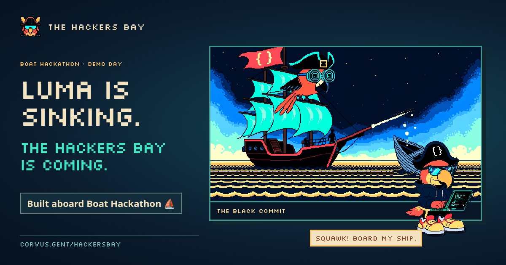

# The Hackers Bay



**Luma is sinking. The Hackers Bay is coming.**

[Live site](https://corvus.gent/hackersbay) · [60-second demo](https://corvus.gent/hackersbay/demo) · [Mac app for Apple Silicon and Intel](https://github.com/Corvus-gent/loading-website/releases/tag/hackersbay-demo-v0.2.0)

Built aboard Boat Hackathon 2026, on the Historic Klamath at Pier 9 in San Francisco. [Boat Hackathon](https://boathackathon.com/) · [ShowBoat Demo Day](https://partiful.com/e/574OkdF3XGK3SzsRR3QK) · [@BoatHackathon](https://x.com/BoatHackathon) · [Pier 9 map](https://www.google.com/maps/search/?api=1&query=Historic+Klamath+Pier+9+San+Francisco)

## Run locally

With Node.js 22 or newer, run one command from the checkout. The default demo needs zero environment variables and no dependency install.

```sh
npm run dev
```

Open [http://127.0.0.1:4173/hackersbay](http://127.0.0.1:4173/hackersbay). Run `npm ci` before enabling optional Redis-backed features.

## Deploy on Vercel

Import this repository as an **Other** project. The checked-in Vercel configuration runs `npm run build`, serves `dist/`, and includes the Hackers Bay API. Leave environment variables empty for the full fallback demo. The root redirects to `/hackersbay`. The canonical live deployment is [corvus.gent/hackersbay](https://corvus.gent/hackersbay).

## What to try

- Equip a pixel parrot pirate from four classes and 20 wearables. Captain Squawk can read a public profile to draft Builds, Wants, and Offers.
- Paste a public event into **Sink a Luma** to see its published details through the Deckhand, Navigator, Quartermaster, or Merchant lens.
- Enter the Demo Day room and follow Captain Squawk to three suggested crewmates. Both sides must agree to reveal a suggested meetup.
- Draft a crew on the organizer’s ship deck or browse the sponsor treasure map. Try **Proof of Build** for a repository preview.
- Watch the autoplay in [vertical](https://corvus.gent/hackersbay/demo?format=vertical) or [wide](https://corvus.gent/hackersbay/demo?format=wide). Press **M** for sound, **Space** to pause, or **R** to replay.

## How the sponsors are used

| Sponsor | Use | Fallback |
| --- | --- | --- |
| [Boat.dev](https://boat.dev/) | Runs approved public repositories in temporary VMs for Proof of Build with `BOAT_DEV_API_KEY` and `HACKERSBAY_BOAT_REPOS`. | A labeled Dockside sample |
| [Context.dev](https://www.context.dev/) | Reads public profile links when `CONTEXT_DEV_API_KEY` is configured. | A plain public-page read and deterministic profile draft |
| [NYTEX](https://nytokenexchange.com/) | TrustedRouter handles confidential persona inference with `TRUSTEDROUTER_API_KEY` or `NYTEX_TRUSTEDROUTER_API_KEY`. | A labeled private-mode demo |

An optional `HACKERSBAY_OPENAI_API_KEY` enables standard persona drafting. `REDIS_TLS_URL` or `REDIS_URL` enables shared intro links across browsers.

## Straight talk

- Public Luma imports use published event facts. If an event page is unavailable, the UI identifies its fictional sample.
- The event details and official RSVP come from Boat Hackathon. The demo pirates, match reasons, traction, and suggested meetups are staged.
- With zero environment variables, intro acceptance runs in one browser. Sponsor services require credentials for live calls. The game, event lenses, and autoplay work without them.

## Project files

- [Electron app](app/) and [Remotion video kit](video/)
- [Hackathon submission](SUBMISSION.md) and [build log](HACKERSBAY_LOG.md)
- [Shot list](SHOTLIST.md), [Compound edit brief](COMPOUND_PROMPT.md), and [LinkedIn drafts](LINKEDIN.md)

## Team and credits

Gabe (Corvus) built The Hackers Bay for Boat Hackathon 2026. Colin Lowenberg’s open-source [luma-clone](https://github.com/opencolin/luma-clone) and [moonbase](https://github.com/opencolin/moonbase) inspired the event and organizer workflows.

[MIT license](LICENSE). Bundled fonts retain the licenses in [the asset directory](public/hackersbay/assets/).
