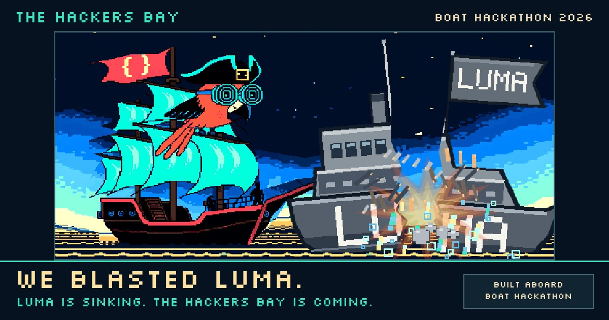

# The Hackers Bay



**Luma is sinking. The Hackers Bay is coming.**

[Live site](https://corvus.gent/hackersbay) · [60-second demo](https://corvus.gent/hackersbay/demo) · [Two-minute pitch and cuts](https://corvus.gent/hackersbay/cuts#pitch)

Built aboard Boat Hackathon 2026, on the Historic Klamath at Pier 9 in San Francisco. [Boat Hackathon](https://boathackathon.com/) · [ShowBoat Demo Day](https://partiful.com/e/574OkdF3XGK3SzsRR3QK) · [@BoatHackathon](https://x.com/BoatHackathon) · [Pier 9 map](https://www.google.com/maps/search/?api=1&query=Historic+Klamath+Pier+9+San+Francisco)

## Run locally

With Node.js 22 or newer, run one command from the checkout. The default demo needs zero environment variables and no dependency install.

```sh
npm run dev
```

Open [http://127.0.0.1:4173/hackersbay](http://127.0.0.1:4173/hackersbay). Run `npm ci` before enabling optional Redis-backed features.

## Deploy on Vercel

Import this repository as an **Other** project. The checked-in Vercel configuration runs `npm run build`, serves `dist/`, and includes the Hackers Bay API. Leave environment variables empty for the full fallback demo. The root redirects to `/hackersbay`. The canonical live deployment is [corvus.gent/hackersbay](https://corvus.gent/hackersbay).

Native Mac app: in the repo ([apps/macos](apps/macos/)), launching later.

## First launch on macOS

For a development build, right-click **HackersBay.app** in Finder and choose **Open**. If Gatekeeper blocks it, try opening once, then go to **System Settings → Privacy & Security → Open Anyway**. The app uses ad hoc signing and ships without Apple notarization.

## What to try

- Equip a pixel parrot pirate from four classes and 20 wearables. Captain Squawk can read a public profile to draft Builds, Wants, and Offers. Try Private Parrot mode for NYTEX confidential inference and a receipt check.
- Paste a public event into **Sink a Luma** to see its published details through the Deckhand, Navigator, Quartermaster, or Merchant lens.
- Run the [Parrot race](https://corvus.gent/hackersbay/race). Four class scouts rank the fictional room. Pick a winner to earn a Golden Feather and meet its three crewmates.
- Enter the Demo Day room and follow Captain Squawk to three suggested crewmates. Both sides must agree to reveal a suggested meetup.
- [Create an event](https://corvus.gent/hackersbay/create) from public Luma details. Share the boarding invite and draft the registered crew on the organizer’s ship deck. See [live crew counts](https://corvus.gent/hackersbay/crew). Browse the sponsor treasure map. Try **Proof of Boat** for a repository preview.
- Watch the autoplay in [vertical](https://corvus.gent/hackersbay/demo?format=vertical) or [wide](https://corvus.gent/hackersbay/demo?format=wide). Press **M** for sound, **Space** to pause, or **R** to replay.

## How the sponsors are used

| Sponsor | Use | Fallback |
| --- | --- | --- |
| [Boat.dev](https://boat.dev/) | Runs a fixed public scout in a short-lived VM. Proof of Boat also previews approved repositories with `BOAT_DEV_API_KEY` and `HACKERSBAY_BOAT_REPOS`. | A labeled Dockside sample |
| [Context.dev](https://www.context.dev/) | Reads public profile links for the standard scout when `CONTEXT_DEV_API_KEY` is configured. | A plain public-page read and deterministic profile draft |
| [NYTEX](https://nytokenexchange.com/) | TrustedRouter handles confidential persona inference and can provide signed receipts with `TRUSTEDROUTER_API_KEY` or `NYTEX_TRUSTEDROUTER_API_KEY`. | A labeled private-mode demo |

`HACKERSBAY_RACE_PROVIDER=boat` enables real race workers when a Boat.dev key and Redis are configured. The default race uses the same ranking in demo mode. An optional `HACKERSBAY_OPENAI_API_KEY` enables standard persona drafting. `REDIS_TLS_URL` or `REDIS_URL` enables shared intro links, organizer rosters, and live crew counts across browsers.

## Straight talk

- Public Luma imports use published event facts. If an event page is unavailable, the UI identifies its fictional sample.
- The event details and official RSVP come from Boat Hackathon. The demo pirates, match reasons, traction, and suggested meetups are staged.
- Private Parrot skips the public scout. With a key, our server sends the public-profile excerpt over HTTPS to TrustedRouter’s confidential route. The creator checks the signed receipt for the original draft. A verified receipt establishes origin and integrity. Without a key, the link yields a local suggestion. [TrustedRouter receipt docs](https://trustedrouter.com/docs/receipts)
- The standard scout sends a Context.dev public-page excerpt to a short-lived Boat.dev sandbox for a fixed processing job. The Context key stays server-side. Live scouts use the Redis-backed budget. The parrot log shows provider results and demo fallbacks.
- With zero environment variables, intro acceptance runs in one browser. Event creation uses a browser-local preview and live totals show as unavailable. The game, event lenses, and autoplay work with the default demo services.

## Project files

- [Native SwiftUI app](apps/macos/), [Electron app](app/), and [Remotion video kit](video/)
- [Hackathon submission](SUBMISSION.md) and [build log](HACKERSBAY_LOG.md)
- [Shot list](SHOTLIST.md), [Compound edit brief](COMPOUND_PROMPT.md), and [LinkedIn drafts](LINKEDIN.md)

## Team and credits

Gabe (Corvus) built The Hackers Bay for Boat Hackathon 2026. Colin Lowenberg’s open-source [luma-clone](https://github.com/opencolin/luma-clone) and [moonbase](https://github.com/opencolin/moonbase) inspired the event and organizer workflows.

[MIT license](LICENSE). Bundled fonts retain the licenses in [the asset directory](public/hackersbay/assets/).

## For terminal pirates

Curl, wget, and HTTPie get Captain Squawk and The Black Commit in ANSI art over HTTPS. Use `curl -L` with a bare hostname to follow the edge redirect. The API returns plain text by default. Add `?json` or `&json` to get structured output. Add `?color=0` to disable ANSI art.

```sh
curl -L corvus.gent/hackersbay
curl 'https://corvus.gent/hackersbay/api/pirate?class=deckhand&json'
curl https://corvus.gent/hackersbay/api/crew
curl 'https://corvus.gent/hackersbay/api/event/boat-hackathon?lens=navigator'
curl 'https://corvus.gent/hackersbay/api/match?me=deckhand'
curl -L corvus.gent/hackersbay/squawk
curl -LN corvus.gent/hackersbay/sink/luma
curl -L corvus.gent/hackersbay/ayay
curl -L corvus.gent/hackersbay/race
```

`me` accepts a class or nickname. To choose a lens for a nickname, send `class` as well. Match reasons come from the fictional Demo Day roster. The crew API reports the same live Redis counters as the website.

The zero-dependency `hackersbay` CLI is ready to package. It has not been published to npm. Run it from the checkout with Node.js 20 or later.

```sh
npx --package ./apps/cli hackersbay
npx --package ./apps/cli hackersbay --class deckhand --name "Copper Byte" --quick
```

Use the arrow keys to change the class and kit. Press Enter for your matches and a share link that opens the exact kit in the browser. The CLI falls back to the bundled Demo Day roster offline.

The browser has hidden cues. Type **ayay** to get a salute from Captain Squawk, an **AYE AYE!** from the crew, and a burst of confetti. Use **↑ ↑ ↓ ↓ ← → ← → B A** for parrot rain, type **ahoy** for a one-shot sea shanty, or open the [creator with Captain Trav’s hat](https://corvus.gent/hackersbay/board?captain=trav). The [Historic Klamath’s hidden ship log](https://corvus.gent/hackersbay/klamath) traces the ferry’s history at Pier 9.

## Standing on Colin’s shoulders

Built on Colin Lowenberg’s luma-clone, moonbase, and sandboxmaxxing ideas.

- **luma-clone.** Used the event record’s slug, start and end times, time zone, venue fields, and event-details layout as a design reference. Hackers Bay uses its own rendering and public Luma importer. [luma-clone event schema](https://github.com/opencolin/luma-clone/blob/506e5ae/db/schema.ts)
- **Moonbase.** Adapted the attendee-sheet CSV quoting and formula guard. The Room composer uses one column definition for the CSV and exports the event roster the organizer is already authorized to see. [Moonbase attendee sheet](https://github.com/opencolin/moonbase/blob/46208d4/lib/attendee-sheet.ts) · [MIT notice](HACKERSBAY_THIRD_PARTY.md)
- **sandboxmaxxing.** Built the same-brief workflow with independent sandbox seats, progressive lane results, and a human-picked winner. The Parrot race compares matching strategies over one fictional roster. [sandboxmaxxing](https://github.com/opencolin/sandboxmaxxing)
- **Provider review.** Studied luxcode’s agent, harness, and provider roles, the cookbook’s session examples, and the Eve adapter’s bounded session lifecycle. That review informs the second-provider issue. [luxcode](https://github.com/opencolin/luxcode) · [Tenki cookbook](https://github.com/opencolin/tenki-cookbook) · [tenki-eve-sandbox](https://github.com/opencolin/tenki-eve-sandbox) · [Provider issue](https://github.com/Corvus-gent/the-hackers-bay/issues/2)

[Contributing guide](CONTRIBUTING.md) · [Colin’s issue queue](https://github.com/Corvus-gent/the-hackers-bay/issues?q=is%3Aissue+label%3Afor-colin)

### Thanks

Thanks to Siebe Barée (@SiebeBaree, github.com/SiebeBaree) for setting up the initial repo.
